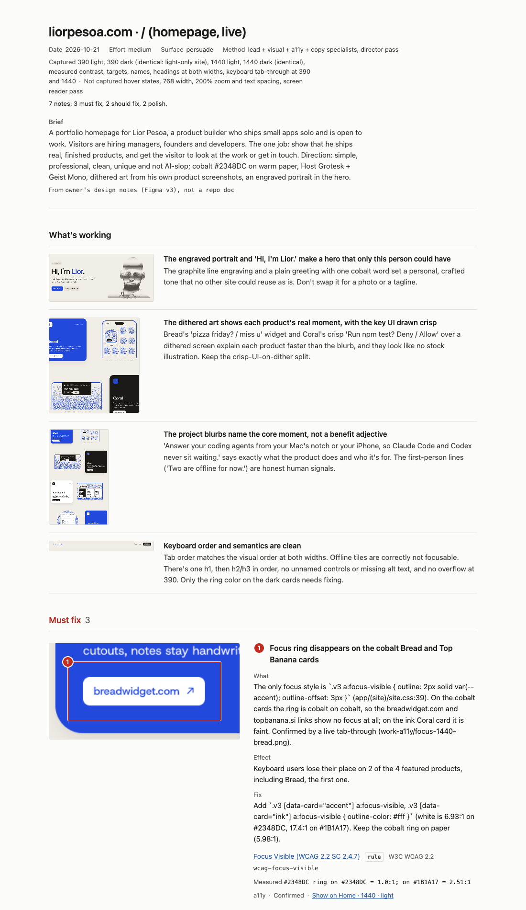

# Skills

Agent skills I use to build and ship my own apps, published so you can use them too. They work in Claude Code and in other agents that read `SKILL.md` files.

## design-crit

A design review of a real, rendered product, the way a senior product designer gives one. It looks at screenshots of your web page or iOS app, grounds every note in a named principle or a measurement, cuts notes that are only taste, and gives you a crit page with each note marked on the screenshot.



What you get for each note:
- **What's wrong and where**, marked on the screenshot.
- **The principle behind it**, linked to its source (WCAG, Apple HIG, Nielsen Norman Group, research on cognitive biases), with how strong the evidence is.
- **What the user experiences** because of it.
- **The fix**, with values: colors, sizes, exact replacement text.

It also tells you what's working, so nobody "fixes" it, and what it couldn't check.

How it works:
1. Reads your `PRODUCT.md`, `DESIGN.md` and design tokens to learn what the screen is for and what direction you chose. It defends that direction instead of pushing its own taste.
2. Captures the screens: phone and desktop widths, light and dark, for web; light, dark and the largest Dynamic Type size in the iOS Simulator. Measures contrast, tap targets, labels and text size from the live page.
3. Runs three reviewers in parallel: visual, accessibility and copy.
4. A director pass cuts anything without a source, anything that would fit any screen, and anything that fights your brief. It merges duplicates and keeps the best 8.
5. Writes `crit.json` and renders the crit page.

It checks for generic, AI-default design and copy (the identical icon-card grid, the purple gradient, "Supercharge your workflow") using dated, sourced lists, and it says "reads generic", never "AI-written".

### Use

```
/design-crit                           # screens touched by your current changes
/design-crit https://example.com       # a URL or a local dev server
/design-crit high                      # the whole flow, all states, 200% zoom
/design-crit a11y                      # one reviewer only
/design-crit --fix                     # apply the Must and Should fixes after the crit
```

Effort levels: `low` (one screen, up to 4 notes), `medium` (default, up to 8), `high` (whole flow, up to 12), `max` (adds a comparison with strong products in the same category).

### Requirements

- Web: Node 18+ and Google Chrome. The capture script uses Playwright (`npm i playwright` in any scratch folder; the skill tells the agent how).
- iOS: Xcode with an iOS Simulator. iOS capture is newer and less tested than web.
- Python 3 for the rule search and the page renderer (standard library only).

## Install

With the [skills CLI](https://github.com/vercel-labs/skills):

```sh
npx skills add lior-pesoa/skills --skill design-crit
```

As a Claude Code plugin:

```
/plugin marketplace add lior-pesoa/skills
/plugin install lior-skills@lior-pesoa
```

Or copy `skills/design-crit` into `~/.claude/skills/`.

## What's inside

```
skills/design-crit/
  SKILL.md                 the crit process
  specialists/             visual, a11y, copy reviewers and the director pass
  references/              rules.csv (sourced rules), anti-slop lists, biases, capture steps, crit.json format
  scripts/                 capture.cjs, measure.js, search.py, render.py
  assets/                  crit page styles and an example run
```

## License

MIT. See [LICENSE](LICENSE).

Made by [Lior Pesoa](https://www.liorpesoa.com).
