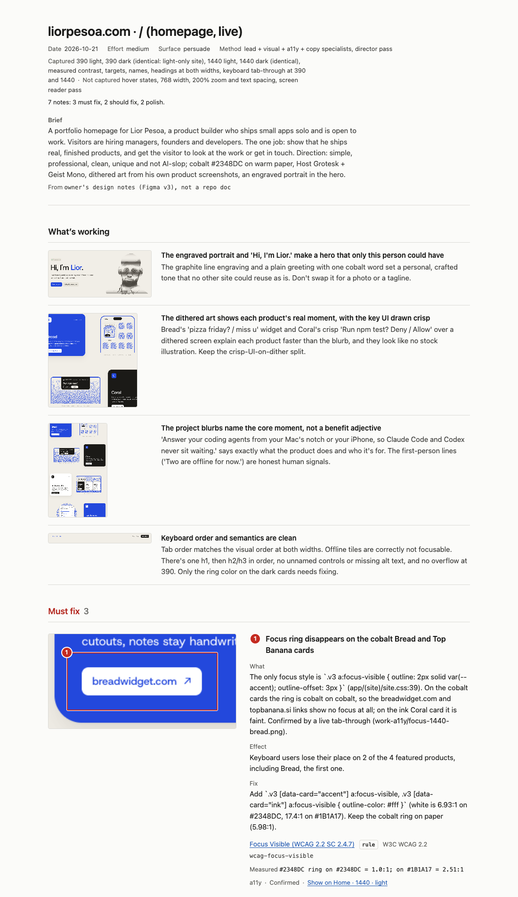

# Skills

Agent skills I use to build and ship my own apps, published so you can use them too. They work in Claude Code and in other agents that read `SKILL.md` files.

## design-crit

A design review of a real, rendered product, the way a senior product designer gives one. It looks at screenshots of your web page or iOS app, grounds every note in a named principle or a measurement, cuts notes that are only taste, and gives you a crit page with each note marked on the screenshot.



What you get for each note:
- **What's wrong and where**, marked on the screenshot.
- **The principle behind it**, linked to its source (WCAG, Apple HIG, Nielsen Norman Group, research on cognitive biases), with how strong the evidence is.
- **What the user experiences** because of it.
- **The fix**, with values: colors, sizes, exact replacement text.

It also tells you what's working, so nobody "fixes" it, and what it couldn't check.

How it works:
1. Reads your `PRODUCT.md`, `DESIGN.md` and design tokens to learn what the screen is for and what direction you chose. It defends that direction instead of pushing its own taste.
2. Captures the screens: phone and desktop widths, light and dark, for web; light, dark and the largest Dynamic Type size in the iOS Simulator. Measures contrast, tap targets, labels and text size from the live page.
3. Runs three reviewers in parallel: visual, accessibility and copy.
4. A director pass cuts anything without a source, anything that would fit any screen, and anything that fights your brief. It merges duplicates and keeps the best 8.
5. Writes `crit.json` and renders the crit page.

It checks for generic, AI-default design and copy (the identical icon-card grid, the purple gradient, "Supercharge your workflow") using dated, sourced lists, and it says "reads generic", never "AI-written".

### Use

```
/design-crit                           # screens touched by your current changes
/design-crit https://example.com       # a URL or a local dev server
/design-crit high                      # the whole flow, all states, 200% zoom
/design-crit a11y                      # one reviewer only
/design-crit --fix                     # apply the Must and Should fixes after the crit
```

Effort levels: `low` (one screen, up to 4 notes), `medium` (default, up to 8), `high` (whole flow, up to 12), `max` (adds a comparison with strong products in the same category).

### Requirements

- Web: Node 18+ and Google Chrome. The capture script uses Playwright (`npm i playwright` in any scratch folder; the skill tells the agent how).
- iOS: Xcode with an iOS Simulator. iOS capture is newer and less tested than web.
- Python 3 for the rule search and the page renderer (standard library only).

## ugc-video

A UGC-style video ad for Instagram Reels, TikTok or Shorts: an AI avatar talks to camera from the bottom-left corner while real screen recordings of your product fill the frame behind. It reads like a creator's tip, and everything on screen is real.

What it does:
1. **Script.** Four short lines (one per avatar clip) and three hooks of different types to test, each line matched to the screen that plays behind it. The avatar never claims to use your product, never claims results, and says no made-up numbers.
2. **Avatar.** The character's background story, a ready-to-paste prompt per clip, the settings, and a plan to keep the voice the same across clips (written from OpenArt, and it maps to similar tools).
3. **Clip check.** Transcribes every clip and flags words the model added or dropped, measures pauses, and lines up framing across clips.
4. **Edit.** Joins the clips into one fast cut (pauses removed, slightly sped up, loudness evened out), removes the background so the avatar stands in the corner like a green-screen creator, and builds the video with [HyperFrames](https://hyperframes.heygen.com): screens cut on the avatar's words, kept clear of the platform's buttons and captions.
5. **Posting notes.** Caption, timed lines for native captions, AI disclosure, music and cover, and an ad link with UTM tags.

### Use

```
/ugc-video                              # start with the brief and the script
/ugc-video avatar                       # character, prompts and settings for your video tool
/ugc-video clip1.mp4 clip2.mp4 ...      # check and edit clips you've made
```

### Requirements

- ffmpeg, and `whisper-cli` (whisper.cpp) with an English model. `npx hyperframes transcribe` downloads one.
- Node 18+ for `npx hyperframes` (render, transcription, background removal; runs locally).
- Python 3, standard library only.
- An account with an AI avatar video tool, and screen recordings of your product from a real phone.

## delegate

A working mode for coding agents: the main agent plans, solves the hard logic and reviews every diff, and subagents on cheaper models write the code from precise specs. A strong model (Opus in Claude Code) gets the code where taste matters; a fast one (Sonnet) gets boilerplate, tests and mechanical edits.

It only delegates work that splits cleanly. Every handoff loses context and adds latency, so changes that are tightly coupled to reasoning the main agent just did, debugging, and iterative UI work stay with the main agent. This follows Anthropic's advice on [when to fold subagents into your main agent loop](https://claude.com/resources/articles/building-agents-when-to-fold-subagents-into-your-main-agent-loop): split along clean interfaces, not along roles.

How it works:
1. **Plan.** The main agent reads the code and solves the hard parts itself: algorithms, concurrency, invariants. "Handle the race condition appropriately" never goes in a spec.
2. **Split.** Work becomes packages that can each be built and reviewed on their own, ideally touching different files, each assigned a model.
3. **Spec.** Every package gets a self-contained spec: context, goal, files to touch and not touch, interfaces, invariants, enumerated edge cases, acceptance criteria with the exact verify command.
4. **Dispatch.** Independent packages run in parallel.
5. **Review.** The main agent reads the real diff against the spec, never the agent's summary. It checks for scope creep, "improved" reference code and the most common failure: the happy path built, the edge cases skipped.
6. **Fix.** Findings go back to the same agent, at most two rounds, then it escalates to a stronger model or the main agent takes the package over.
7. **Verify.** The main agent runs the tests and build itself and reports which model built what and what review caught.

### Use

```
/delegate                               # or just ask for a feature; it triggers on separable implementation work
```

### Requirements

- An agent that can start subagents and pick their model. It's written for Claude Code (Agent tool with `model: "opus"` or `"sonnet"`, SendMessage for fix rounds).
- A git repo, so the main agent can review diffs.

## migrate-to-fable-5-2

A migration pass for prompts and agent setups moving to Claude Fable 5.2 or Claude Mythos 5.2. It follows Anthropic's guide, [Prompting Claude Fable 5.2](https://platform.claude.com/docs/en/build-with-claude/prompt-engineering/prompting-claude-fable-5-2), which lists what to change when you carry a prompt, a skill or a harness over from an earlier model.

The API changes in a new model return a 400, so you find them. The changes in this guide don't raise errors: an effort level tuned on another model, a system prompt line that stopped working, a memory file full of old cautions. They show up as cost, slow turns and worse results.

How it works:
1. **Ask.** Reads the repo first, then asks what it can't find there: the model you're moving from, whether someone watches the agent work, what you've seen on Fable 5.2 so far, and whether to edit or only report.
2. **Inventory.** Lists every place instructions reach the model: system prompts, `CLAUDE.md`, skills, agent files, memory, notes, tool descriptions and the code that builds requests.
3. **Effort.** Sets `effort` to `high` explicitly and plans a sweep at `medium` and `xhigh` on your evals. It won't call a level tuned when nothing measured it.
4. **Audit.** Checks the inventory for nine kinds of leftover from earlier models: standing orders to delegate, a token budget shown to the model, code that edits earlier turns, "treat that answer as done" lines, "don't think" lines, hard style rules, cautions that piled up in memory, requests to write reasoning into the response, and approval rules that are too broad.
5. **Fix what you saw.** Matches each behavior you observed (early stops, unneeded approvals, silent turns, too many subagents, duplicated code, dense reports, refusals, slow easy requests) to the fix from the guide, with Anthropic's suggested text, its measured effect and its token cost.
6. **Report.** Findings with file and line, what changed, what it left alone and why, and what to measure next.

It adds a fix only for a behavior someone observed. Each one costs tokens: in Anthropic's testing the finishing text raised output tokens by about 30% and the code-ownership sentence by 70 to 80%. Adding them all up front makes the agent slower and hides which change did what.

### Use

```
/migrate-to-fable-5-2                   # or describe what changed since you switched; it triggers on the symptoms too
```

### Requirements

- An agent that reads `SKILL.md` files. There are no scripts to install.
- It covers prompts and behavior. For the API changes (model IDs, parameters that now return a 400), use Anthropic's [migration guide](https://platform.claude.com/docs/en/models/fable-5-2/migration-guide), or `/claude-api migrate this project to claude-fable-5-2` in Claude Code.

## Install

With the [skills CLI](https://github.com/vercel-labs/skills):

```sh
npx skills add lior-pesoa/skills --skill design-crit
npx skills add lior-pesoa/skills --skill ugc-video
npx skills add lior-pesoa/skills --skill delegate
npx skills add lior-pesoa/skills --skill migrate-to-fable-5-2
```

As a Claude Code plugin:

```
/plugin marketplace add lior-pesoa/skills
/plugin install lior-skills@lior-pesoa
```

Or copy `skills/design-crit`, `skills/ugc-video`, `skills/delegate` or `skills/migrate-to-fable-5-2` into `~/.claude/skills/`.

## What's inside

```
skills/design-crit/
  SKILL.md                 the crit process
  specialists/             visual, a11y, copy reviewers and the director pass
  references/              rules.csv (sourced rules), anti-slop lists, biases, capture steps, crit.json format
  scripts/                 capture.cjs, measure.js, search.py, render.py
  assets/                  crit page styles and an example run

skills/ugc-video/
  SKILL.md                 brief → script → avatar → clip check → edit → posting notes
  references/              script and hook rules, avatar prompts and voice, layout and safe zones, posting
  scripts/                 clip-report.py, build-avatar.py, caption-groups.py
  templates/index.html     the HyperFrames composition

skills/delegate/
  SKILL.md                 when to delegate, the spec template, review and fix loop

skills/migrate-to-fable-5-2/
  SKILL.md                 questions → inventory → effort → audit → fixes → report
  references/              leftovers from earlier models and how to find them; observed behaviors and their fixes
```

## License

MIT. See [LICENSE](LICENSE).

Made by [Lior Pesoa](https://www.liorpesoa.com).
